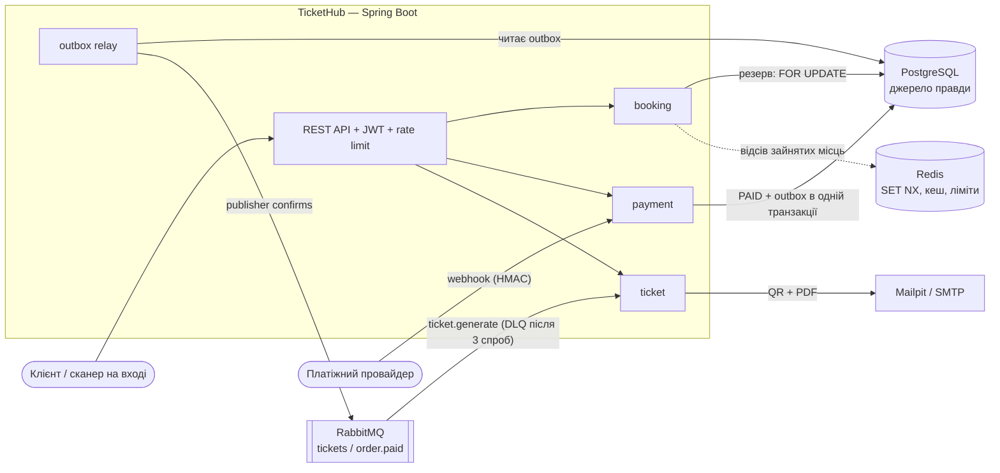
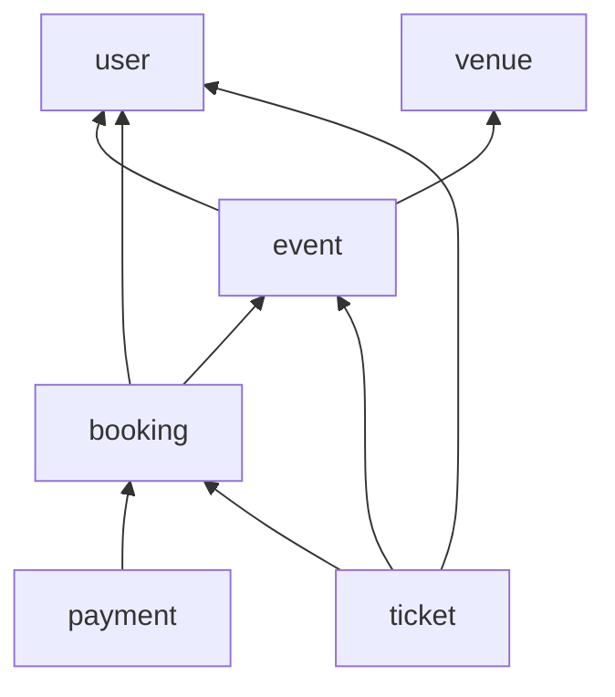

# TicketHub

Бекенд сервісу продажу квитків на події з вибором конкретного місця в залі.
Головна інженерна задача — коректний продаж при одночасних покупках: одне місце ніколи не продається двічі.

**Стек:** Java 21 · Spring Boot 3.5 · Spring Security + JWT (jjwt) · PostgreSQL 16 · Redis 7 + Bucket4j · RabbitMQ · OpenPDF + ZXing · Spring Mail · Flyway · MapStruct · springdoc-openapi · JUnit 5 + Testcontainers.

## Запуск

Потрібні Docker і JDK 17+ для запуску Gradle (JDK 21 для компіляції Gradle завантажить сам через toolchains).

```bash
docker compose up -d postgres redis rabbitmq mailpit   # інфраструктура
./gradlew bootRun --args='--spring.profiles.active=local'
```

Або все разом, включно із застосунком у контейнері: `docker compose up --build`.

| Що | Адреса |
|---|---|
| API | http://localhost:8080/api/v1 |
| Swagger UI | http://localhost:8080/swagger-ui.html |
| RabbitMQ консоль | http://localhost:15672 (guest / guest) |
| Mailpit | http://localhost:8025 |

Профіль `local` додає демо-дані (`db/seed/R__seed_demo.sql`): зал «Палац мистецтв» на 200 місць,
одну опубліковану подію і користувачів (пароль у всіх — `password`):

| Email | Роль |
|---|---|
| `admin@tickethub.local` | ADMIN |
| `organizer@tickethub.local` | ORGANIZER |
| `user@tickethub.local` | USER |

Поза профілем `local` застосунок не стартує без секретів: `TICKETHUB_SECURITY_JWT_SECRET`
(base64, щонайменше 256 біт, наприклад `openssl rand -base64 64`) і `TICKETHUB_PAYMENT_WEBHOOK_SECRET`.

## Автентифікація

```bash
curl -X POST localhost:8080/api/v1/auth/login -H 'Content-Type: application/json' \
     -d '{"email":"organizer@tickethub.local","password":"password"}'
# → { "tokenType": "Bearer", "accessToken": "...", "accessTokenExpiresAt": "...", "refreshToken": "..." }
```

- **Access-токен** — JWT (HS512), живе 15 хв, передається як `Authorization: Bearer ...`. Перевіряється без звернення до БД.
- **Refresh-токен** — випадковий непрозорий рядок, живе 7 днів, у БД зберігається лише його SHA-256 хеш.
  Кожен `POST /auth/refresh` погашає старий токен і видає нову пару (ротація). Повторне використання вже
  погашеного токена вважається крадіжкою: відкликаються всі сесії користувача.
- **Ролі:** самореєстрація завжди дає `USER`; `ORGANIZER`/`ADMIN` призначає адміністратор (`PUT /users/{id}/role`).
- **Власник події** перевіряється через `@PreAuthorize("hasRole('ORGANIZER') and @eventSecurity.isOwner(#id, authentication)")`.
  Неіснуюча подія дає 404, чужа — 403; чернетки для сторонніх не існують (404).
- **Блокування** (`POST /users/{id}/block`) відкликає всі refresh-токени; уже виданий access-токен доживає свої ≤15 хв —
  свідомий компроміс stateless-підходу.

## Бронювання без подвійного продажу

```
POST /api/v1/orders
Authorization: Bearer ...
Idempotency-Key: 7b1e4f0a-2c55-4d8e-9a61-0f3c2b7d9e11

{ "eventId": "...", "eventSeatIds": ["...", "..."] }
```

- **Все або нічого:** якщо хоч одне місце зайняте — `409` зі списком `unavailableSeatIds`, жодне місце не резервується.
- **Резерв на 10 хвилин:** місця → `RESERVED`, замовлення → `PENDING` з `expiresAt`. `ExpiredReservationJob` кожні 30 с
  переводить прострочені замовлення в `EXPIRED` і повертає місця в продаж. Порції беруться через
  `SELECT ... FOR UPDATE SKIP LOCKED`, тож кілька інстансів не обробять одне замовлення двічі (ShedLock не потрібен).
- **Ідемпотентність:** повтор із тим самим `Idempotency-Key` повертає вже створене замовлення (`200` замість `201`),
  навіть якщо два однакові запити прийшли паралельно. Той самий ключ з іншим набором місць — `422`.
- **Межі модулів:** `booking` не торкається репозиторіїв `event` — статуси місць змінює лише `EventSeatService`,
  в транзакції викликача (`Propagation.MANDATORY`), тож резерв місць і замовлення комітяться разом.

### Дві стратегії блокування

Перемикаються властивістю `tickethub.booking.locking`:

| | `pessimistic` (за замовчуванням) | `optimistic` |
|---|---|---|
| Механізм | `SELECT ... FOR NO KEY UPDATE`, рядки блокуються в порядку `id` | `@Version`, `UPDATE ... WHERE version = ?` |
| Конкурент | чекає на блокування, потім бачить `RESERVED` → 409 | отримує 0 оновлених рядків → 409 |
| Deadlock на перехресних наборах | неможливий завдяки порядку блокування | неможливий, Hibernate впорядковує UPDATE |

`ReservationConcurrencyTest` запускається для обох стратегій на реальному Postgres (Testcontainers):

| Сценарій | Результат (обидві стратегії) |
|---|---|
| 50 покупців одночасно на одне місце | 1 замовлення `PENDING`, 49 × `409`, жодної іншої помилки |
| 30 покупців на 3 спільні місця у випадковому порядку | 1 переможець, 29 × `409`, без deadlock |

Тест перевірено «саботажем»: якщо прибрати `FOR UPDATE`, він падає. Подвійного продажу при цьому все одно немає —
його ловлять `@Version` і частковий унікальний індекс `order_items` — але покупці отримують помилки замість чистих 409.
Під навантаженням k6 — див. [нижче](#навантаження).

## Redis: прискорення без ризику для коректності

PostgreSQL — єдине джерело правди про статус місця. Redis лише знімає навантаження, і його збій
**не зупиняє продаж**: усі звернення до Redis мають таймаут 500 мс і при помилці пропускаються (fail-open).
Це перевіряє `RedisOutageIT`: контейнер Redis ставиться на паузу, а замовлення, карта місць і логін продовжують працювати.

- **Швидкий відсів зайнятих місць.** Перед транзакцією Lua-скрипт атомарно для всього набору місць робить
  `SET seat:{eventSeatId} <userId:Idempotency-Key> NX EX 600`. Якщо хоч одне місце вже застовпив інший покупець —
  одразу `409`, без з'єднання з Postgres і без черги на блокуваннях рядків. Якщо БД потім відмовила,
  щойно поставлені ключі знімаються; при скасуванні чи протуханні замовлення — теж.
  Вимикається `tickethub.booking.redis-claims.enabled=false` (для порівняння «з Redis і без» в k6).
- **Кеш карти місць.** `GET /events/{id}/seats` кешується на 3 с і скидається після коміту кожної зміни статусів.
- **Rate limiting (Bucket4j, бакети в Redis — ліміт спільний для всіх інстансів):**
  `POST /auth/login` — 10/хв на IP (брутфорс), `POST /orders` — 20/хв на користувача (боти-скальпери).
  Перевищення — `429` з `Retry-After`.

Свідомі компроміси: карта місць може відставати від БД до 3 с; якщо Redis впаде між постановкою ключа і його зняттям,
місце до 10 хв може отримувати хибний `409` (але ніколи — подвійний продаж).
За балансувальником потрібен `server.forward-headers-strategy`, інакше ліміт логіну рахуватиметься на IP проксі.

## Оплата і квитки

```
POST /orders/{id}/pay  →  сторінка провайдера  →  webhook (HMAC)  →  одна транзакція:
                                                   Payment SUCCEEDED, Order PAID, місця SOLD, запис в outbox
outbox-relay (1 с)  →  RabbitMQ: tickets / order.paid  →  ticket.generate  →  квитки + QR + PDF + email
                                                          └─ 3 ретраї з backoff → ticket.generate.dlq
```

- **Фейковий провайдер** — справжньої платіжки в MVP немає. `POST /orders/{id}/pay` повертає `checkoutUrl`:
  відкрийте його в браузері й натисніть «Оплатити» чи «Відхилити» — провайдер надішле підписаний webhook.
- **Webhook** підписано HMAC-SHA256 від `{timestamp}.{тіло}` (заголовки `X-Signature`, `X-Timestamp`):
  підроблений, змінений або перехоплений і повторений пізніше ніж за 5 хв запит відхиляється з `401`.
  Повторна доставка того самого webhook нічого не змінює.
- **Запізніла оплата.** Якщо гроші прийшли після протухання резерву: місця досі вільні — продаємо їх цьому замовленню;
  уже зайняті іншим або замовлення скасоване — автоматичний refund і статус `REFUNDED`.
- **Transactional outbox.** Подія `order.paid` пишеться в таблицю `outbox` у тій самій транзакції, що й `PAID`,
  тож не губиться, навіть якщо RabbitMQ недоступний у момент оплати. Relay позначає подію надісланою лише після
  publisher confirm від брокера. Доставка at-least-once, тому генерація квитків ідемпотентна.
- **Квитки.** На кожне місце — квиток із 192-бітним випадковим кодом у QR (ZXing) і PDF (OpenPDF; шрифт DejaVu Sans
  вбудовано, бо стандартні шрифти PDF не мають кирилиці). PDF зберігаються в `tickethub.tickets.storage-dir`
  і перегенеровуються, якщо файл зник. Лист із квитками — у Mailpit: http://localhost:8025.
- **Вхід.** `POST /tickets/scan {eventId, code}` — лише організатор цієї події. Квиток пропускає рівно один раз,
  навіть якщо два сканери зчитали його одночасно; повтор — `409` з часом першого проходу.

## Архітектура



Модульний моноліт, package-by-feature. Кожен модуль має `api`, `domain`, `repository`, `service`;
залежності між модулями йдуть лише в один бік:



(Усі модулі також залежать від `common`.)

`ArchitectureTest` (ArchUnit) перевіряє ці межі на байткоді при кожній збірці:
- між модулями немає циклів;
- `common` не знає про модулі;
- чужі `repository` і контролери недоступні — лише сервіси модуля-власника;
- репозиторії викликаються тільки з сервісів;
- `domain` не залежить від `service`, `api` чи `repository`.

Ключове рішення моделі: фізичне місце в залі (`Seat`) і місце на конкретну подію (`EventSeat`) — різні сутності.
Цілісність захищена на рівні БД: `UNIQUE (event_id, seat_id)` і частковий унікальний індекс
`order_items(event_seat_id) WHERE active`.

## Тести

```bash
./gradlew build   # тести + ArchUnit + поріг покриття
```

Інтеграційні тести (`*IT`) піднімають справжні PostgreSQL, Redis, RabbitMQ і Mailpit через Testcontainers, тому потрібен запущений Docker.
`PurchaseFlowE2EIT` проходить увесь сценарій: резерв → оплата → webhook по HTTP → outbox → RabbitMQ → лист із PDF → сканування.

**Покриття (JaCoCo):** 93% рядків, 76% гілок. `./gradlew check` падає, якщо воно опуститься нижче 90% / 70%.
Звіт — `build/reports/jacoco/test/html/index.html`; у CI відсоток пишеться в summary запуску, а HTML-звіти
зберігаються як артефакт.

## Навантаження

Сценарій k6 «відкриття продажу» ([load/](load/README.md)): 100 покупців без пауз штурмують перші ряди залу на 1000 місць,
паралельно 100 переглядів карти місць за секунду. Застосунок обмежено 2 CPU.

| | З Redis | Без Redis |
|---|---|---|
| `POST /orders`, запитів/с | **1165 – 1567** | 751 – 779 |
| `POST /orders`, p95 | **149 – 186 мс** | 312 – 331 мс |
| Подвійних продажів | 0 | 0 |

## План

- [x] **Етап 1. Каркас і каталог** — Flyway-схема, зали з генерацією місць, CRUD подій, цінові зони, каталог з фільтрами, RFC 7807, Swagger, Testcontainers
- [x] **Етап 2. Користувачі й безпека** — реєстрація, JWT + refresh, ролі, перевірка власника
- [x] **Етап 3. Бронювання** — `EventSeat`, публікація, `POST /orders` з песимістичним блокуванням, ідемпотентність, протухання резервів, тест на 50 потоків
- [x] **Етап 4. Redis** — `SET NX EX`, кеш карти місць, rate limiting
- [x] **Етап 5. Оплата і квитки** — фейковий провайдер, HMAC-webhook, outbox, RabbitMQ, QR + PDF, email
- [x] **Етап 6. Полірування** — JaCoCo, ArchUnit, k6, діаграма архітектури
